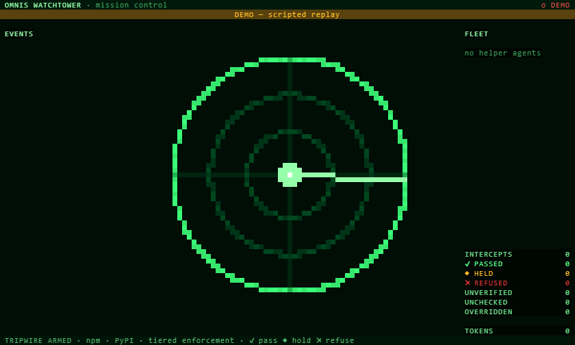

# Omnis Watchtower

Mission control for your coding agents, with a supply-chain tripwire bolted on.

Coding agents install packages without anyone reading the name. They invent names that don't
exist (and attackers register those names), they fall for typosquats, and they pull in releases
that went up an hour ago. Watchtower checks every npm and PyPI install any agent in the session
tries to run, before it runs, and shows the whole fleet doing it on a demoscene radar in your
terminal.



## What it does

- **Refuses** installs that are plainly bad: names that don't exist, known malware, typosquats of
  popular packages, and public packages shadowing one of your private ones. The agent gets the
  evidence and usually picks the right package on its own.
- **Pins** brand-new releases of popular packages. If `zod` shipped a version three hours ago,
  `npm i zod` runs as `npm i zod@<the previous release>` and the agent is told why. Hijacked
  releases tend to get caught within a day or two, so a 72-hour cooldown closes that window
  without slowing anyone down.
- **Holds** anything suspicious but not conclusive, and sends a **Sentinel**: a hidden, read-only
  investigator subagent that reads the registry page, the repository and the install scripts,
  then returns a verdict. The agent carries on with other work and the verdict is applied when it
  retries.
- **Shows** it all live: agents launching and orbiting, packages arriving at the ring and turning
  green, amber or red, Sentinels flying out to scan. Radar is the default look, and there's a
  cracktro theme for when you want copper bars.

## Numbers, measured (not claimed)

- **1,000 popular packages** (top 500 npm, top 500 PyPI) scored against the live registries:
  998 passed (59 of them pinned), **0 refused**, 2 held, each of the two with two genuine warning
  signs. Details in [docs/validation/benign-sweep-2026-10.md](docs/validation/benign-sweep-2026-10.md).
- **Decision time**: 468 ms median and 1.06 s at the 95th percentile for a package seen for the
  first time, and effectively instant from cache.
  [docs/validation/latency-2026-10.md](docs/validation/latency-2026-10.md).
- **Zero runtime dependencies.** A supply-chain tool with no supply chain of its own.

## Install

Needs Claude Code **2.1.296 or later**.

```text
/plugin marketplace add Fortitude-Group/omnis-watchtower
/plugin install omnis-watchtower@omnis-watchtower
```

That's it. The tripwire is on from the next session. Open mission control with `/watchtower`,
or let it dock itself when your terminal is at least 144 columns wide.

## Commands

| Command | What it does |
|---|---|
| `/watchtower` | Open mission control |
| `/watchtower theme radar\|cracktro` | Switch the look (remembered) |
| `/watchtower legend` | Explain every figure on screen: what it is, why it matters, what to do |
| `/watchtower demo` | Replay a scripted attack, offline, no real installs |
| `/watchtower status` | Totals, investigations in flight, overrides, faults |
| `/watchtower allow <eco:pkg>[@ver] [--permanent]` | Let a refused package through. **Human only** |
| `/watchtower block <eco:pkg> [--permanent]` | Always refuse a package. **Human only** |
| `/watchtower overrides [clear <eco:pkg>]` | List or remove overrides |
| `/watchtower recheck <eco:pkg>[@ver]` | Forget the cached verdict and investigate again. **Human only** |

`allow`, `block` and `recheck` only count when you type them at the prompt, so a blocked agent
can't unblock itself. If an agent asks for an `allow` or `block`, the request is parked and a
Confirm button appears in the pane. An agent's `recheck` is simply refused, because rerunning
the Sentinel until it says yes would be a way round the rule.

## Settings

Change these in Claude Code's plugin config menu.

| Setting | Default | |
|---|---|---|
| `mode` | `enforce` | `warn-only` reports everything but never refuses |
| `strict` | off | Refuse installs if Watchtower itself faults (normally it lets them through and shouts about it) |
| `theme` | `radar` | or `cracktro` |
| `autoOpen` | on | Dock the pane at session start on wide terminals |
| `reducedMotion` | off | Static effects, at most 4 frames a second |
| `sentinelModel` | `haiku` | or `sonnet` |
| `sentinelTimeoutSec` | `180` | How long a held package waits for a verdict before it's refused (60 to 900) |
| `privateAllowlist` | (empty) | Comma-separated globs for private packages, e.g. `@acme/*, acme-*`. Internal packages served through a company mirror without their own scope belong here: Watchtower can't tell an internal name from one an agent invented, so otherwise it refuses them |

## Privacy

Nothing goes to Fortitude Omnis. Watchtower talks to the public registries (npm, PyPI), OSV,
deps.dev and the public download-count APIs, and only about packages your agents are installing.

Packages that resolve to a private registry (from your `.npmrc`, `pip.conf`, `PIP_INDEX_URL` or
the allowlist) are never scored against public data. The one exception: Watchtower asks the
public registry whether the same name exists there, because that's how dependency confusion is
caught. That single lookup does reveal the name to the public registry. The trade-off is spelt out
in [src/plugin/adapters/facts.ts](src/plugin/adapters/facts.ts).

## What it isn't

- **Not a sandbox.** It decides whether an install should run. It doesn't run installs in
  isolation, and it doesn't analyse arbitrary shell. `curl … | sh` is allowed and flagged on the
  map as unchecked.
- **npm and PyPI only** for now. pnpm, yarn, bun, npx, pip, uv, poetry and pipx are all read,
  along with requirements files and lockfile diffs. Cargo, Go, gems and NuGet are not.
- **Terminal only** for now. The desktop app shows a short note instead of the map. The renderer
  is written so a desktop version can be added without touching the rest.

## Development

Plugin source is in `src/plugin`. The core (parsing, scoring, the scene model and the renderer) is
plain TypeScript with no engine dependency, so it runs under vitest. Everything that touches
Claude Code goes through small ports built in the hook files.

```text
node scripts/sync-engine-types.mjs           # copy the plugin API types in (git-ignored)
npm run typecheck                            # both tsconfigs
npm test                                     # vitest: core, adapters, corpora, renderer goldens
npm run validate                             # claude plugin validate src/plugin
npm run test:plugin                          # engine tests against the real host
WT_LIVE=1 npx vitest run tests/live          # the live sweep and latency checks (network, minutes)
```

Specs, plan and research live in `specs/001-omnis-watchtower/`.

---

Built by [Fortitude Omnis Group](https://fortitude-omnis.group).
